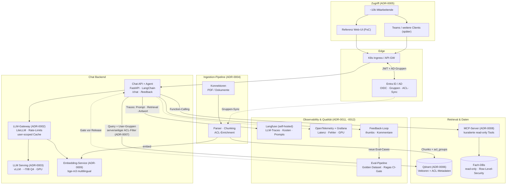

# Architektur – „Chat with your Data"

Alles läuft OnPrem im Kubernetes-Cluster (ADR-0001). Zwei Datenpfade: Dokumente über RAG (Qdrant), strukturierte Daten über kuratierte MCP-Tools. LLM und Embeddings hängen hinter einem Gateway und sind austauschbar.

## Architekturdiagramm

## Request-Flow (eine Chat-Anfrage)

1. **Auth:** Nutzer → Ingress → OIDC-Token (Entra ID) mit AD-Gruppen
2. **Orchestrierung:** Agent entscheidet – RAG-Pfad, Tool-Calls via MCP, oder beides
3. **Retrieval:** Qdrant-Query mit **serverseitigem ACL-Filter** (User-Gruppen vs. `acl_groups`-Payload) → nur berechtigte Chunks
4. **Generation:** Kontext + System-Prompt ("nur aus Kontext antworten") → LLM-Gateway → vLLM
5. **Antwort:** Text + **Citations** (doc_id, Seite) → Nutzer kann jede Aussage prüfen
6. **Nachvollziehbarkeit:** kompletter Trace in Langfuse (Modellversion, Chunks, Latenz, Kosten)
7. **Qualität:** Feedback fließt ins Golden Dataset; CI-Evals verhindern Regressionen

## Komponenten-Übersicht

| Komponente | Technologie | ADR |
|---|---|---|
| Deployment | Kubernetes onPrem, GPU-Nodepool | 0001 |
| Chat-Backend / Agent | FastAPI, LangChain | 0005, 0004 |
| LLM-Gateway | LiteLLM Proxy | 0002 |
| LLM-Serving | vLLM, ~70B Q4 (Sizing offen) | 0003 |
| Embeddings | bge-m3 / multilingual-e5, self-hosted | 0009 |
| Vektor-DB | Qdrant (ACL-Payload-Filter) | 0006, 0007 |
| Strukturierte Daten | MCP-Server, kuratierte Tools | 0008 |
| Auth | Entra ID / AD, OIDC | 0005, 0007 |
| LLM-Observability | Langfuse (self-hosted) | 0011 |
| Infra-Observability | OpenTelemetry + Grafana | 0011 |
| Eval | Golden Dataset, Ragas/DeepEval, Feedback-API | 0012 |
| Halluzinationsschutz | RAG + Citations (Reranking/Groundedness als Roadmap) | 0010 |

## Zentrale Risiken & Mitigation

| Risiko | Mitigation | ADR |
|---|---|---|
| Personenbezogene Daten leaken über Prompt-Cache/Traces | User-scoped Cache-Keys, Langfuse-Zugriff + Retention, Pseudonymisierung | 0002, 0011 |
| Rechte-Drift (Quell-ACLs vs. Index) | Inkrementeller ACL-Sync, max. Sync-Latenz als SLO, Audit-Log | 0007 |
| Halluzination trotz RAG | Citations-Pflicht; Eval-Gate (Groundedness); Roadmap: Reranking/Groundedness-Check | 0010, 0012 |
| Modellqualität onPrem < Cloud-LLM | ~70B-Klasse + Quantisierung; Gateway erlaubt Wechsel; Eval misst objektiv | 0002, 0003 |
| GPU-Kapazität für 10k MA | Continuous Batching, Queue-Backpressure, horizontale Skalierung; Lasttest vor Rollout | 0003 |

## Grobe Phasenplanung (Orientierung)

| Phase | Inhalt | Grob-Schätzung |
|---|---|---|
| 0 – Setup | GPU-Nodes, Qdrant, Gateway, Langfuse im Cluster | 1–2 Wochen |
| 1 – PoC | Ingestion (PDFs), RAG-Basis, Chat-API, Referenz-UI, Citations | 3–4 Wochen |
| 2 – Härtung | ACL-Filter + AD-Sync, MCP-Tools, Golden Dataset + CI-Evals | 3–4 Wochen |
| 3 – Pilot | Fachbereich-Pilot (~100 MA), Feedback-Loop, Lasttest | 4–6 Wochen |
| 4 – Rollout | Stufenweiser Ausbau, Kanal-Entscheidung (Teams/Web), Betriebsübergabe | fortlaufend |

*Annahme: 2–3 Personen, bestehende K8s-Plattform, Fachbereiche liefern Golden-Dataset-Fragen.*
